# whatif-kit

Make and post your own **"What if X kept happening and couldn't stop?"** YouTube Shorts. Each one has real physics, a low-poly 3D world, a time-lapse HUD, calm captions and a synthesized score. A coding agent does the building and you pick the topic.

| | | | |
| --- | --- | --- | --- |
| 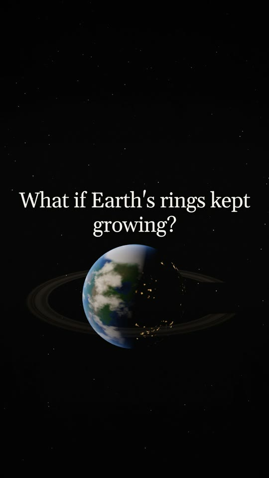 | 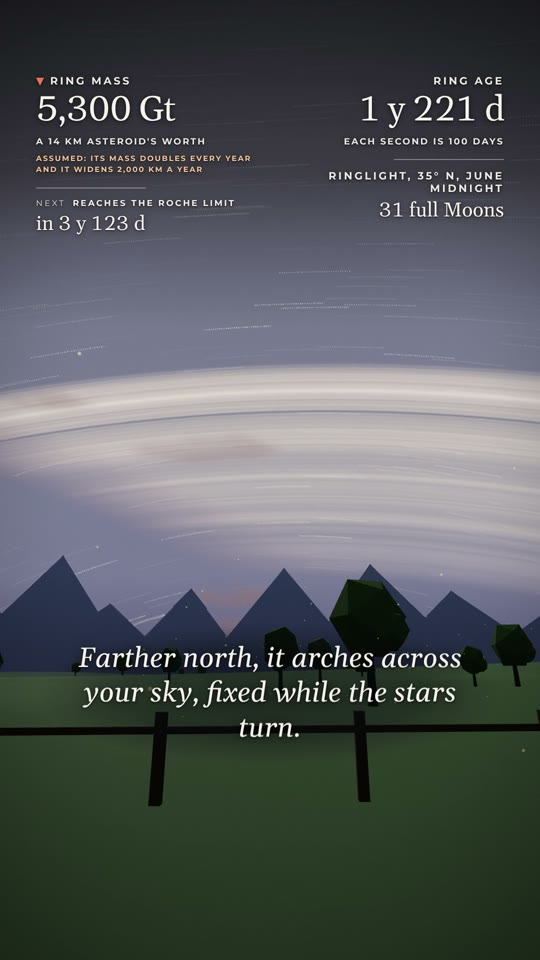 | 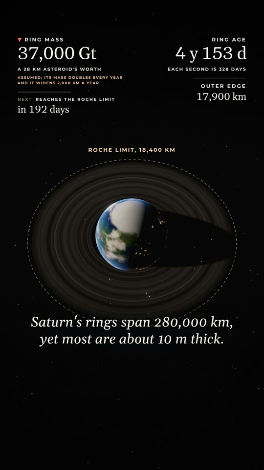 | 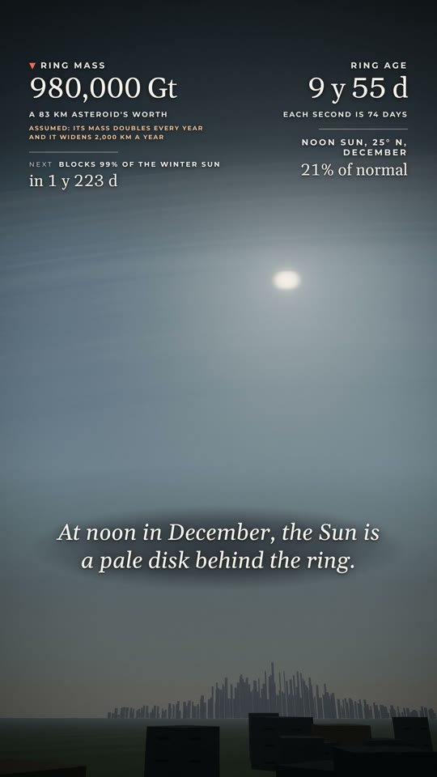 |

*Stills from "What if Earth's rings kept growing?", made with this workflow.*

## Made with it

| | | | |
| --- | --- | --- | --- |
| 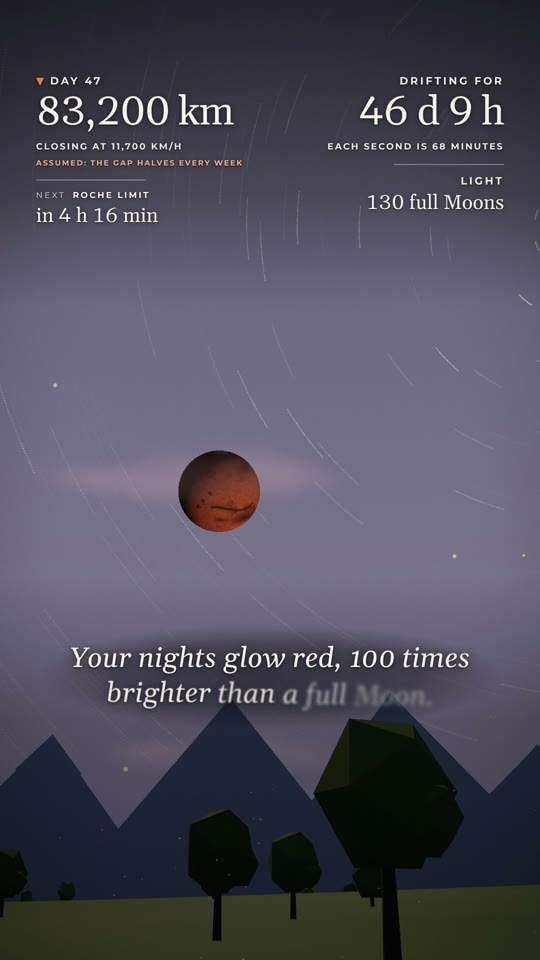 | 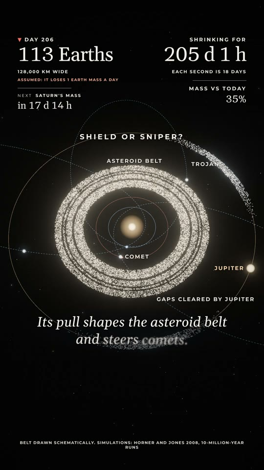 | 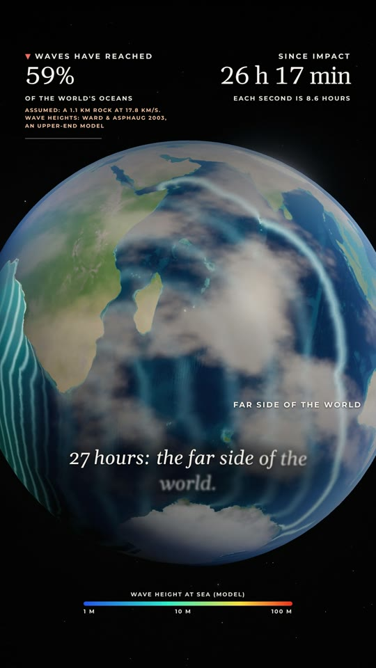 | 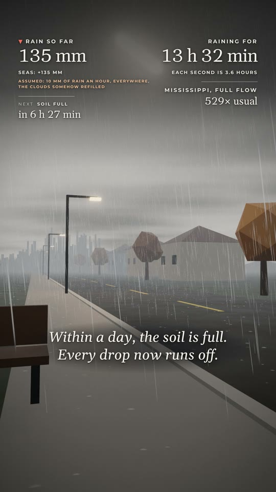 |
| Mars drifting toward Earth | Jupiter shrinking away | Asteroid waves that don't stop | Rain that never stops |
| 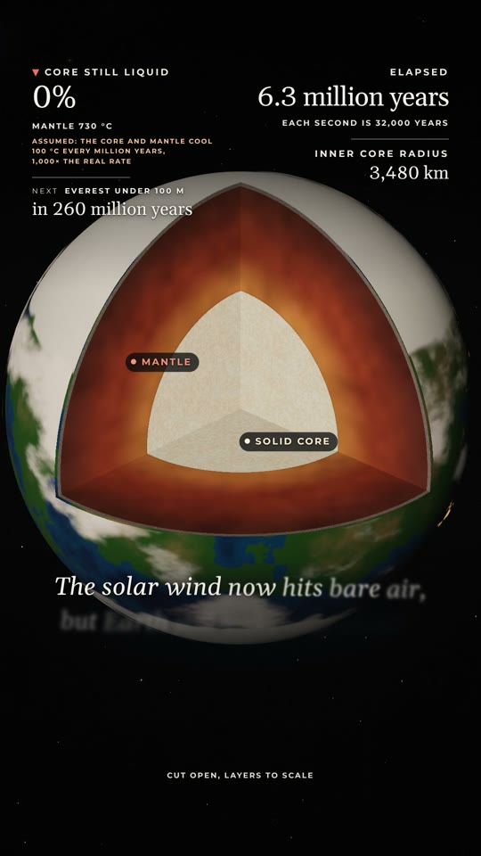 | 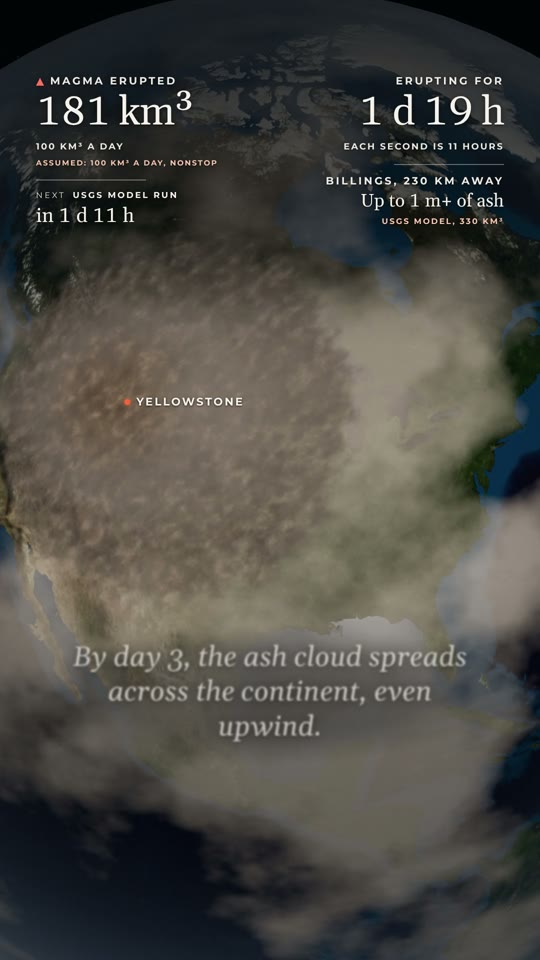 | 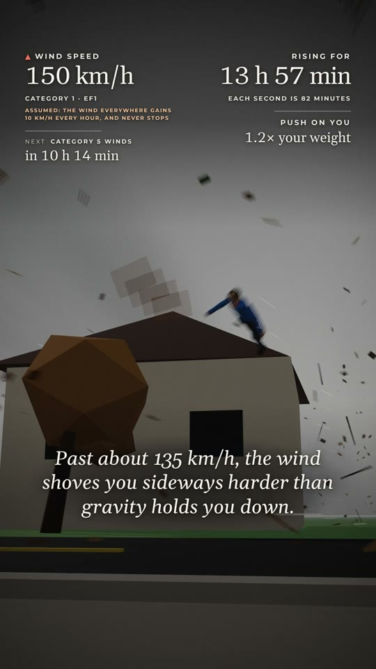 | 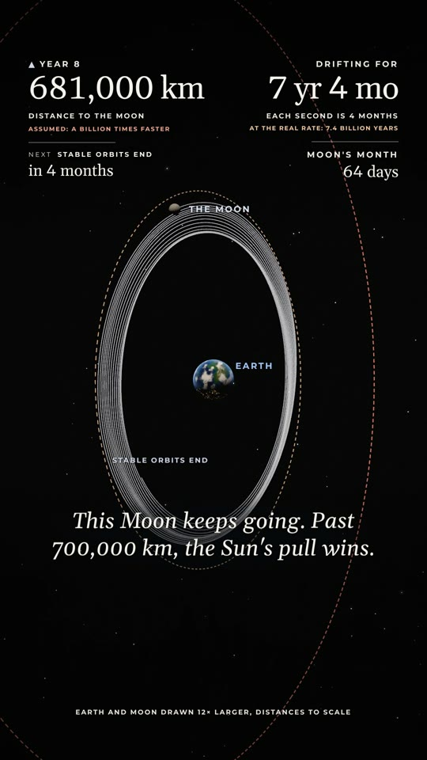 |
| Earth's core cooling | A supervolcano that keeps erupting | Wind that keeps getting stronger | The Moon drifting away |

Every one follows the same six steps below, from the same template.

## You need

- A coding agent: Claude Code, Codex or Cursor
- Node 22+, Python 3 with `numpy` and `scipy`, and `ffmpeg`

## The workflow

**1. Pick a topic.** Choose something that keeps growing or shrinking with no end: the Moon falling, the oceans draining, the Sun shrinking, a ring that doubles every year. It works best when real physics turns it into a few surprising milestones. Search YouTube first so you're not making the same video as someone else.

**2. Start a project.**

```bash
git clone https://github.com/castor639/whatif-kit && cd whatif-kit
bin/new oceans-draining
```

**3. Hand it to your agent.** Open the folder in your agent and paste this:

```
Read PROMPT.md and build videos/oceans-draining: "What if the oceans kept draining and couldn't stop?"
```

The agent researches the science, writes a model that computes every number on screen, writes the captions, cuts the shots, scores it and checks every frame. That takes from 30 minutes to a couple of hours.

**4. Check it yourself.**

```bash
bin/check videos/oceans-draining              # should report 0 errors
bin/snap videos/oceans-draining 5,15,30,50    # stills in .hyperframes/snap/
```

Look at the stills. If something looks off, tell the agent what to fix in plain words: "the night shot is too dark", "the caption at 0:20 is too long".

**5. Render.**

```bash
bin/render videos/oceans-draining 60
```

The MP4 lands in `videos/oceans-draining/renders/`. A 60-second, 60 fps Short renders much faster on a machine with a GPU, so expect anything from 20 minutes to a few hours.

**6. Upload.** Post it as a YouTube Short (9:16 and under 3 minutes, so it's picked up automatically).

- **Title:** `What If the Oceans Kept Draining and Couldn't Stop? #Shorts`
- **Description:** two or three plain sentences. Open with the setup, give one striking number from the video, and say which parts are real science and which rate you made up. End with `#Shorts #WhatIf #Science` plus a topic tag.
- **Pinned comment:** your sources. People will check your numbers, and having the sources there earns trust.

Then pick the next topic. Posting steadily matters more than posting a perfect one.

## What's in here

```
PROMPT.md          the build brief your agent follows
template/          a finished Moon Short to build from, plus ENGINE.md (the engine API)
bin/new            copy the template to videos/<name>
bin/check          lint and check (builds the audio first)
bin/snap           stills at chosen seconds
bin/render         render the MP4 and print its size and loudness
```

Your videos live in `videos/`, which git ignores.

## License

The code is MIT. The Gelasio fonts are under the SIL Open Font License (`template/fonts/OFL.txt`).
